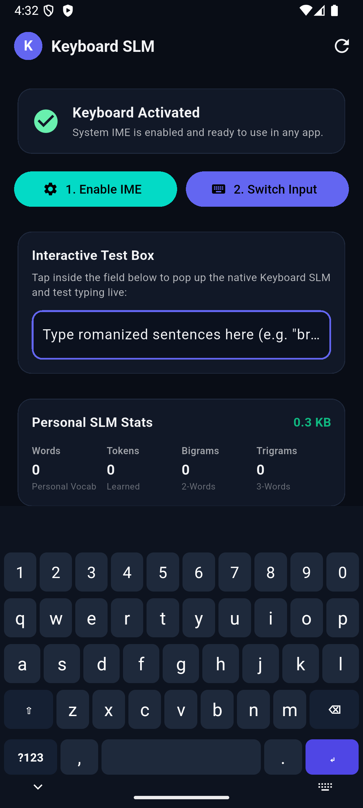
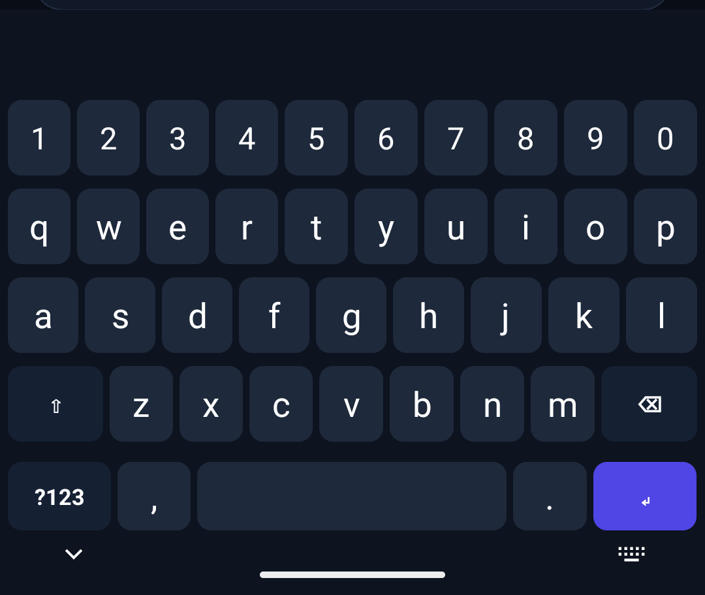

# Keyboard SLM

**A private, on-device Android keyboard that learns how you type.**

Keyboard SLM is a personal keyboard for people who type their native language in Latin script (Hinglish, Tenglish, Tanglish and mixed styles). A tiny language model written in C++ runs entirely on the phone, predicts your next word, and keeps learning from what you type. No cloud, no telemetry.

<p align="center">
  
  &nbsp;&nbsp;
  
</p>

## Features

- **Top-3 suggestion strip**: tap to insert, long-press to make the model forget a word.
- **Language-agnostic**: learns your own spellings and language mix; no fixed dictionary.
- **Optional chat import**: bootstrap your vocabulary from a WhatsApp `.txt` export, or skip it.
- **Private by design**: 100% on-device. Password fields, OTPs, URLs, emails and card-like numbers are never learned.
- **Autocomplete off by default**: suggestions are tap-only, nothing is replaced behind your back.
- **Gboard-sized layout**: number row, shift and caps lock (double-tap), symbols layer, haptics, spacebar-swipe cursor, nav-bar-safe bottom row.

## How it works

The engine (`engine/`) is an interpolated trigram / bigram / unigram model with:

- sentence-start context and a recency boost,
- prefix, exact, phonetic and fuzzy (typo) matching, with merging of spelling variants,
- UTF-8 aware tokenizing (Indic, Arabic, Cyrillic, Latin-1, emoji),
- bounded memory with count decay,
- checksummed, atomically written binary persistence,
- a thread-safe C API used from Kotlin through JNI.

On chat-style text, held-out evaluation shows it saves roughly **40-48%** of letters typed (about 30% when trained on only ~150 messages). Prediction latency is about 95 µs.

## Repository layout

| Path | What it is |
|---|---|
| `engine/` | C++17 engine, C API, unit tests (114 checks), evaluation and CLI sandbox |
| `app/` | Flutter companion app and the native Kotlin `InputMethodService` keyboard |
| `web/` | Localhost testbed: phone mockup, Top-3 bar, chat import |
| `scripts/dev.sh` | Build, install, enable and screenshot on the emulator or a USB phone |

## Getting started

### Engine tests

```bash
clang++ -std=c++17 -O2 -Wall -Wextra engine/keyboard_slm_engine.cpp engine/test_engine.cpp -o engine/test_engine
./engine/test_engine
```

### Try it in the browser

```bash
clang++ -std=c++17 -O2 -shared -fPIC engine/keyboard_slm_engine.cpp engine/keyboard_slm_c_api.cpp -o engine/libkeyboard_slm.dylib
python3 web/server.py 8080   # then open http://localhost:8080
```

On Linux, build a `.so` instead of `.dylib` and adjust the path in `web/server.py`.

### Run on Android

Requires Flutter, the Android SDK, NDK 27 and CMake 3.22.

```bash
./scripts/dev.sh            # emulator
./scripts/dev.sh --device   # USB phone (enable USB debugging first)
```

Or manually: `cd app/android && ./gradlew assembleDebug`, install the APK, then enable **Keyboard SLM** in system settings.

## Privacy

Everything stays on the device. The model file lives in app-private storage. The app ships with no personal data; any trained model or chat export must never be committed (see `.gitignore`).

## Roadmap

- Auto-capitalization, double-space period, swipe-backspace
- Key preview popups and long-press alternates
- Themes, dictionary manager, backup/export
- Bundled clean English seed dictionary
- Play Store release build

## Status

Early alpha. Feedback and issues are welcome.
